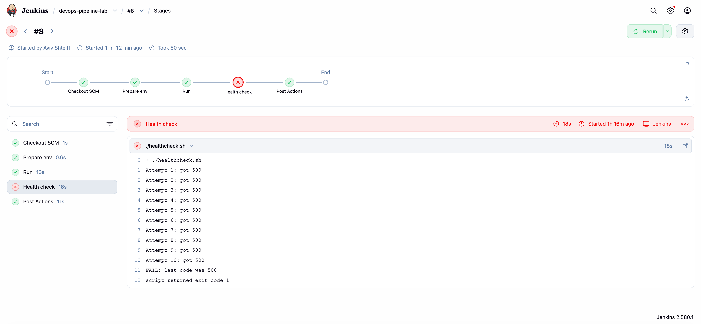
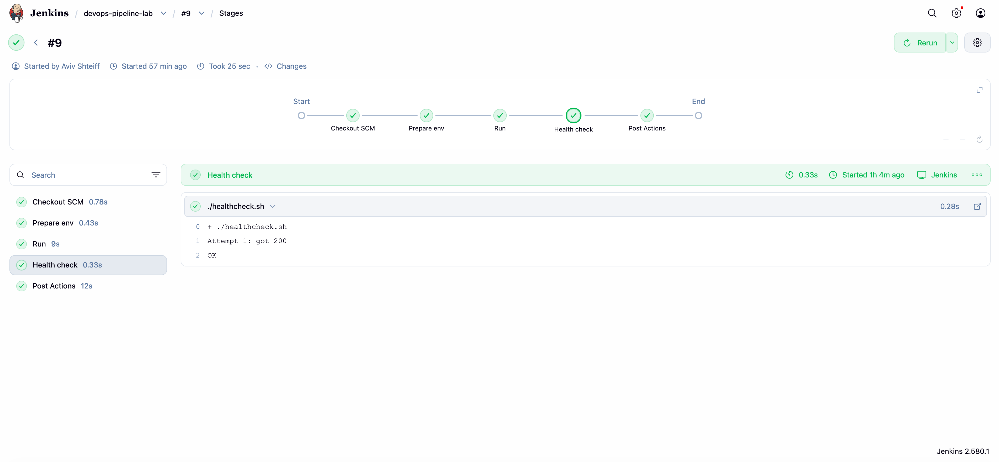

# DevOps Pipeline Lab

A hands-on project: a Node.js (Express) API backed by PostgreSQL, run as two containers with Docker Compose, and built, started and verified automatically by a Jenkins pipeline on a single Ubuntu VM.

The goal was to practice the full loop of a basic CI flow on infrastructure I set up myself: Linux server, Docker and Docker Compose, Jenkins (including secrets handling), a Bash health check, and Git.

## How it works

```
Local machine (VS Code) --git push--> GitHub --polled by--> Jenkins (Ubuntu VM)
                                                               |
     Prepare .env -> docker compose up -> Health check -> Cleanup

docker compose
  ├── app  (Node.js, port 3000, published to the host)
  └── db   (PostgreSQL 16, port 5432 internal only, named volume pgdata)
```

1. I push a commit to `main` on GitHub.
2. Jenkins polls the repository about every 5 minutes (Poll SCM). When it finds a new commit, it starts a run.
3. The pipeline writes the database settings from a Jenkins credential into a `.env` file, starts both containers with Docker Compose, runs a Bash health check against the application, and always cleans up at the end: the containers, the database volume and the `.env` file.
4. A green run means the application **and** its database connection work, because `/health` queries the database.

## Environment

- Ubuntu Server 24.04 in VirtualBox (4 GB RAM, 2 cores), with NAT and port forwarding from my machine (`127.0.0.1`): `2222` -> `22` (SSH), `8080` -> `8080` (Jenkins), `3000` -> `3000` (application)
- Jenkins installed with `apt`, running as a systemd service under the `jenkins` user, which is a member of the `docker` group
- Docker and the Docker Compose plugin on the same VM, so Jenkins builds and runs containers on the local Docker daemon
- Application: Node.js 24 (Alpine image), Express, `pg` as the PostgreSQL driver
- Database: official `postgres:16` image, reachable only inside the Compose network

## Project structure

```
devops-pipeline-lab/
├── app/                  # Express application (server.js, package.json)
├── docs/                 # Screenshots of pipeline runs
├── docker-compose.yaml   # app and db services
├── Dockerfile
├── healthcheck.sh        # Bash health check with retries
├── Jenkinsfile           # Declarative pipeline
├── .env.example          # Template for the database settings
├── .dockerignore
├── .gitignore
└── README.md
```

## Application

| Endpoint | Behavior |
|----------|----------|
| `/` | Returns a plain text message |
| `/health` | Runs `SELECT 1` against PostgreSQL. Returns `200` with `{"status":"ok","db":"up"}` if it succeeds, and `500` with `{"status":"error","db":"down"}` if it fails |

The connection settings come from environment variables (`DB_HOST`, `DB_USER`, `DB_PASSWORD`, `DB_NAME`), so no connection details are hardcoded in the code. If the database becomes unavailable, the application keeps running and `/health` reports it by returning `500`.

In `docker-compose.yaml`, the `db` service uses the named volume `pgdata` and a `pg_isready` healthcheck, and the `app` service sets `DB_HOST=db` (the service name is the hostname on the Compose network).

## Pipeline stages

| Stage | What it does |
|-------|--------------|
| Checkout SCM | Jenkins pulls the repository into its workspace (automatic) |
| Prepare env | `withCredentials` exposes the Secret file credential `devops-lab-env` (three lines: `DB_USER`, `DB_PASSWORD`, `DB_NAME`) as a temporary file, and a `cp` writes it to `.env`. Jenkins masks the file path in the console log |
| Run | `docker compose up -d --build` builds the image and starts `db` and `app` |
| Health check | Runs `./healthcheck.sh` |
| Post (always) | Prints the last 30 log lines of each service, runs `docker compose down -v`, and deletes `.env`, even when an earlier stage failed |

Trigger: Poll SCM with the schedule `H/5 * * * *`.

## Health check script

`healthcheck.sh` sends a request to `http://localhost:3000/health` and checks the HTTP status code.

- Up to 10 attempts, 2 seconds apart (configurable through variables at the top of the script)
- Exit code `0` as soon as it gets `200`
- Exit code `1` if all attempts fail, which fails the Jenkins stage

The retries are needed because `docker compose up -d` returns before the application is ready to serve requests. The status code also tells the failure apart: `500` means the application is running but cannot reach the database, while `000` means the application itself is not answering.

## Verified behavior

I checked the success path, a database failure, and recovery:

- **Manual test:** stopping the `db` container made `/health` return `500` and `healthcheck.sh` exit with `1`. Starting it again brought `/health` back to `200` without restarting the application.
- **Failed run (#8):** the containers started and the database was healthy, but `/health` returned `500` on all 10 attempts, so the run failed. The `post` block still removed the containers, the volume and `.env`. The cause was a leftover `pgdata` volume from an earlier manual run: Jenkins used the same Compose project name, and PostgreSQL ignores the `POSTGRES_*` variables when the volume already holds data, so the database kept the old password. Compose reported the database as healthy because `pg_isready` does not log in; only the application's `/health` caught the problem.
- **Successful run (#9):** `down -v` had deleted the old volume, the next run created a fresh one with the credentials from Jenkins, and the health check returned `200` on the first attempt.

| | |
|---|---|
| Failed run: the health check gets `500` ten times, and the cleanup still runs |  |
| Successful run: the health check gets `200` on the first attempt |  |

## Run it manually

```bash
git clone https://github.com/Aviv-Shteiff/devops-pipeline-lab.git
cd devops-pipeline-lab
cp .env.example .env          # then edit .env and set a real password
docker compose up -d --build
./healthcheck.sh
docker compose down -v        # -v also deletes the database volume
```

## Design decisions

- **Poll SCM instead of a webhook.** The VM is behind NAT and only reachable from my own machine, so GitHub cannot call Jenkins. With Poll SCM, Jenkins makes the outgoing request itself.
- **Secrets stay out of Git and out of the image.** Settings live in a Jenkins Secret file credential, `.env` is ignored by both `.gitignore` and `.dockerignore`, and the repository only contains `.env.example`. The pipeline creates `.env` for the run and deletes it in `post`, with `|| true` on the cleanup commands so one failing command cannot skip the deletion.
- **`/health` checks the database.** It runs a real query through the application's own connection, so it fails if the database is unreachable or the credentials are wrong. The `pg_isready` healthcheck in Compose only shows that PostgreSQL accepts connections, so on its own it cannot catch a wrong password.
- **`depends_on` with `service_healthy`.** The application container starts only after the database healthcheck passes, so the two do not race at startup.
- **Named volume for the data, `down -v` in CI.** In normal use the volume keeps the data when containers are replaced. In the pipeline, `down -v` deletes it, so every run starts from an empty database and a leftover volume cannot affect the result.
- **Hardened container.** The Dockerfile ends with `USER node`, so the process can read and run the code but not modify it. The database port is not published, so only containers on the Compose network can reach it.
- **Small, cache-friendly image.** `node:24-alpine`, with `package*.json` copied and `npm install` run before the code is copied, so a change in `server.js` reuses the cached install layer.

## Security notes

- Membership in the `docker` group is effectively root access on the host. This is acceptable for an isolated lab VM, but not for a shared or production server.
- The repository is public, so Jenkins clones it without a credential. The database settings are the only secret.
- Jenkins is reachable only through the VM's port forwarding on my own machine.

## Problems I ran into

- **`set -e` and the retry loop.** With `set -e`, a failing `curl` ended the script on the first attempt, before the retry. The fix was `|| true` on that line.
- **Jenkins and Docker permissions.** The `jenkins` user had to be in the `docker` group to use the Docker socket.
- **Stale database volume.** A leftover volume kept an old password, and the health check failed with `500` (run #8, described under "Verified behavior"). Fixed by `down -v` in the pipeline.

## Possible improvements

- Push the image to a registry so the same tested image can be deployed elsewhere, instead of existing only on the VM
- Use a GitHub webhook instead of polling (this requires Jenkins to be reachable from GitHub)
- Run Jenkins agents separately from the Docker host