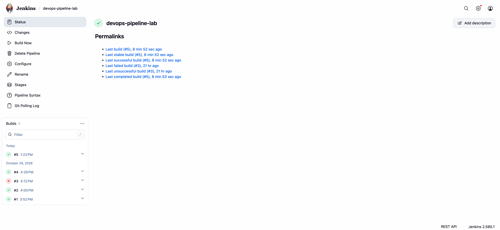
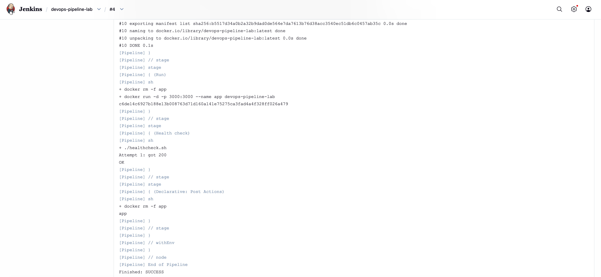
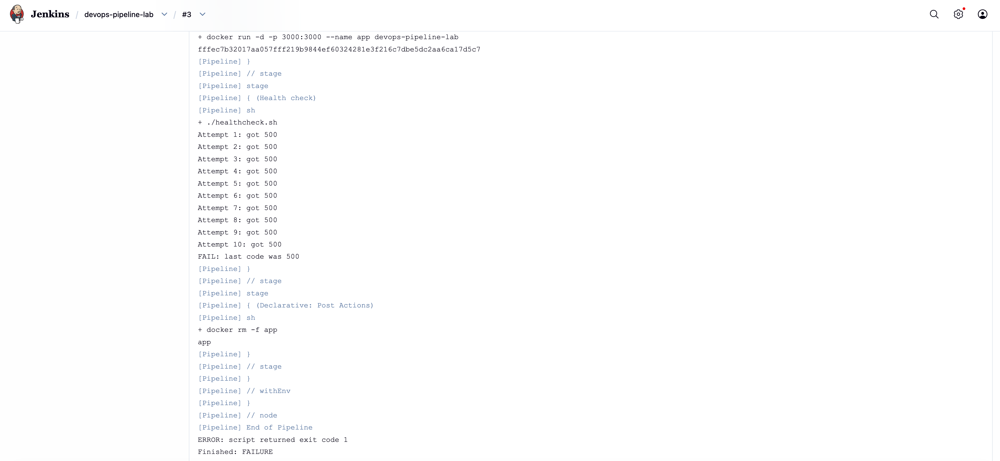
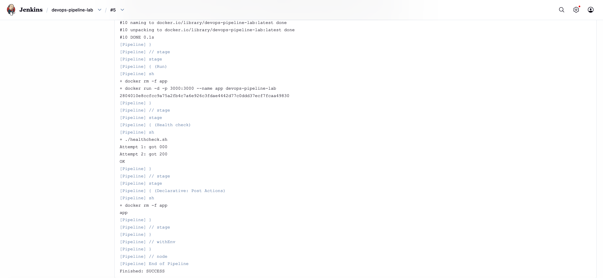

# DevOps Pipeline Lab

A small hands-on project: a Node.js (Express) API packaged in a Docker container, built, started and verified automatically by a Jenkins pipeline running on a single Ubuntu VM.

The goal was to practice the full loop of a basic CI flow on infrastructure I set up myself: Linux server, Docker, Jenkins, a Bash health check, and Git.

## How it works

```
Mac (VS Code) --git push--> GitHub --polled by--> Jenkins (Ubuntu VM)
                                                     |
                                       Build image -> Run container -> Health check -> Cleanup
```

1. I push a commit to `main` on GitHub.
2. Jenkins polls the repository about every 5 minutes (Poll SCM). When it finds a new commit, it starts a run.
3. The pipeline builds the Docker image, starts a container, runs a health check against it, and always removes the container at the end.
4. The run is green only if the health check passed.

## Environment

- Ubuntu Server 24.04 in VirtualBox, 4 GB RAM, 2 cores
- NAT networking with port forwarding from my machine (`127.0.0.1`) to the VM:
  - `2222` -> `22` (SSH)
  - `8080` -> `8080` (Jenkins)
  - `3000` -> `3000` (application)
- Jenkins installed with `apt` and running as a systemd service under the `jenkins` user, which is a member of the `docker` group
- Docker installed on the same VM, so Jenkins builds and runs containers on the local Docker daemon
- Application: Node.js 24 (Alpine image), Express, with `/` and `/health` endpoints

## Project structure

```
devops-pipeline-lab/
├── app/                 # Express application (server.js, package.json)
├── docs/                # Screenshots of pipeline runs
├── Dockerfile
├── healthcheck.sh       # Bash health check with retries
├── Jenkinsfile          # Declarative pipeline
├── .dockerignore
└── README.md
```

## Pipeline stages

| Stage | What it does |
|-------|--------------|
| Checkout SCM | Jenkins pulls the repository into its workspace (automatic) |
| Build | `docker build -t devops-pipeline-lab .` |
| Run | Removes a leftover container if one exists (`docker rm -f app`), then `docker run -d -p 3000:3000 --name app devops-pipeline-lab` |
| Health check | Runs `./healthcheck.sh` |
| Post (always) | `docker rm -f app`, so the container is cleaned up even when the run fails |

Trigger: Poll SCM with the schedule `H/5 * * * *`.

## Health check script

`healthcheck.sh` sends a request to `http://localhost:3000/health` and checks the HTTP status code.

- Up to 10 attempts, 2 seconds apart (configurable through variables at the top of the script)
- Exit code `0` as soon as it gets `200`
- Exit code `1` if all attempts fail, which fails the Jenkins stage

The retries are needed because `docker run -d` returns immediately, before the application inside the container is listening. In build #5 the first attempt got `000` (no response) and the second got `200`.

## Verified behavior

I tested success, a deliberate failure, and recovery:

- Green run: the health check returns `200`
- Forced failure: I changed `/health` to return `500`. The health check failed after 10 attempts, the run turned red, and the `post` block still removed the container
- Reverted the change and the next run was green again

| | |
|---|---|
| Build history (the single red run, #3, is the deliberate failure) |  |
| Successful run |  |
| Failed run (deliberate 500) |  |
| Run where the retry was needed (`000`, then `200`) |  |

## Run it manually

```bash
git clone https://github.com/Aviv-Shteiff/devops-pipeline-lab.git
cd devops-pipeline-lab
docker build -t devops-pipeline-lab .
docker run -d -p 3000:3000 --name app devops-pipeline-lab
./healthcheck.sh
docker rm -f app
```

## Design decisions

- **Poll SCM instead of a webhook.** The VM is behind NAT and only reachable from my own machine, so GitHub cannot call Jenkins. With Poll SCM, Jenkins makes the outgoing request itself.
- **`node:24-alpine`.** A currently supported LTS release, on Alpine to keep the image small.
- **Dependencies installed before copying the code.** `package*.json` is copied and `npm install` runs first, so a change in `server.js` reuses the cached install layer.
- **`.dockerignore`.** Keeps `node_modules` and `.git` out of the build context.
- **Non-root container.** The Dockerfile ends with `USER node`. Files stay owned by root, so the process can read and run the code but not modify it.
- **`docker rm -f` for cleanup.** One command that stops and removes the container, and does not fail when it does not exist.

## Security notes

- Membership in the `docker` group is effectively root access on the host. This is acceptable for an isolated lab VM, but not for a shared or production server.
- The repository is public, so Jenkins needs no credentials. A private repository would require a credential configured in Jenkins.
- Jenkins is reachable only through the VM's port forwarding on my own machine.

## Problems I ran into

- **`set -e` and the retry loop.** With `set -e`, a failing `curl` ended the script on the first attempt, before the retry. The fix was `|| true` on that line.
- **Jenkins and Docker permissions.** The `jenkins` user had to be in the `docker` group to use the Docker socket.

## Possible improvements

- Add a test stage before building the image
- Push the image to a registry instead of keeping it only on the VM
- Use a webhook through a public host or tunnel instead of polling
- Run Jenkins agents separately from the Docker host